# POS System Cafe — Frontend

> **Developed by Songhai Yeanlang**

A modern Point of Sale (POS) and Cafe Management System built with **Vue 3**, **Vite**, **Pinia**, **Vue Router**, and **Bootstrap 5**. Supports bilingual interfaces (**English** & **Khmer**), dual-currency checkout (**USD** & **KHR**), role-based access control (**Owner** & **Staff**), inventory & recipe (BOM) deduction, cashier shift & drawer reconciliation, promo codes, reports, and system audit logs.

---

## 👨‍💻 Developer Note

- **Author / Developer:** **Songhai Yeanlang**
- **Project:** Cafe & Coffee Shop POS System (Frontend)
- **Tech Stack:** Vue 3 (Composition API), Vite, Pinia, Vue Router, Axios, Day.js, Bootstrap 5 & Bootstrap Icons

---

## 🖼️ System UI Screenshots

### 1. Executive Dashboard (`pageDashboard.png`)
Overview of net sales, net profit, paid orders, expenses, sales trends, payment channels, top-selling items, and low-stock alerts.

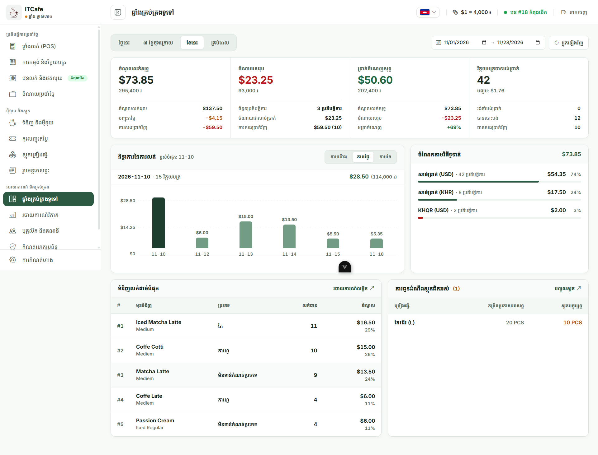

---

### 2. POS Terminal (`pagePos.png`)
Cashier checkout screen with category filtering, drink customization (size, sugar level, ice level, add-ons), promo code / discount application, hold orders, and dual-currency (USD/KHR) payment processing.

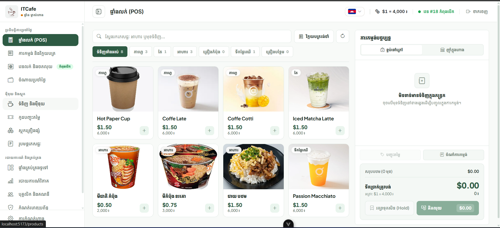

---

### 3. Staff Portal View — Role-Based Access (`pageOnlyStaff.png`)
Dedicated Staff/Cashier portal showing role-permitted navigation and operations in Khmer/English.

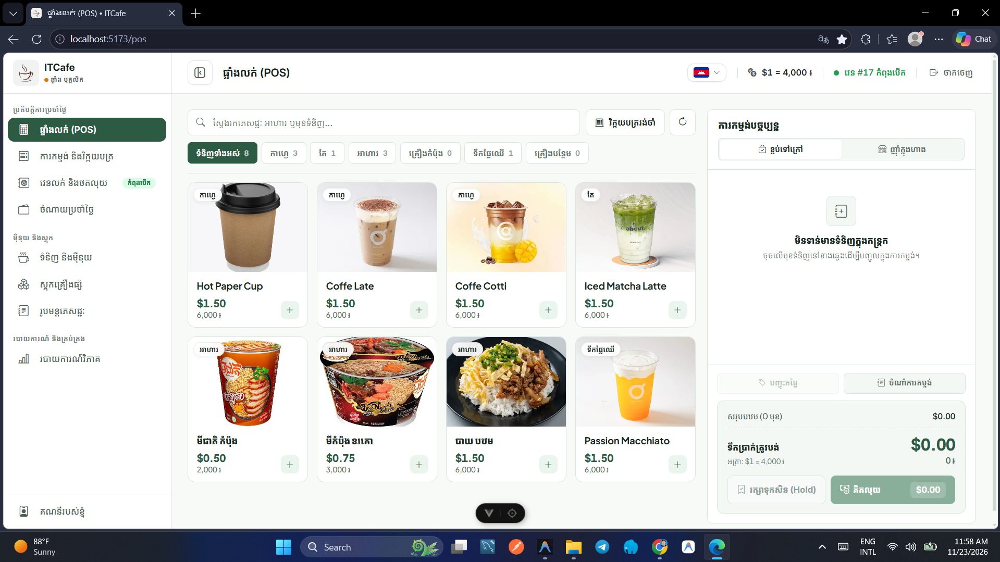

---

### 4. Orders & Receipts History (`pageOrdersReceipts.png`)
Complete transaction log for orders, completed payments, and refunds with live receipt preview and thermal receipt printing.

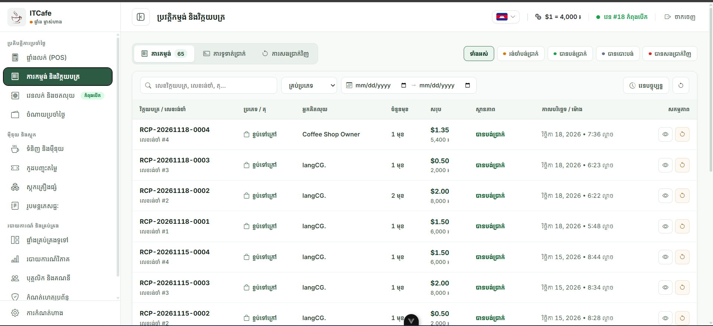

---

### 5. Shifts & Cash Drawer (`pageShifts.png`)
Cashier shift opening/closing workflow, real-time expected vs. counted cash reconciliation (USD & KHR), and shift history logs.

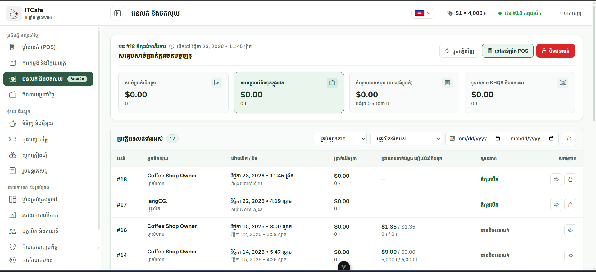

---

### 6. Daily Expenses (`pageDailyExpenses.png`)
Track daily shop expenses by category, payment method, and currency with shift cash drawer deduction and void tracking.

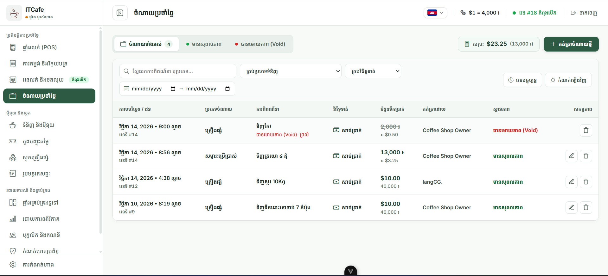

---

### 7. Products & Menu Catalog (`pageMenu.png`)
Manage drinks, food, add-ons, product categories, pricing variants, and product images.

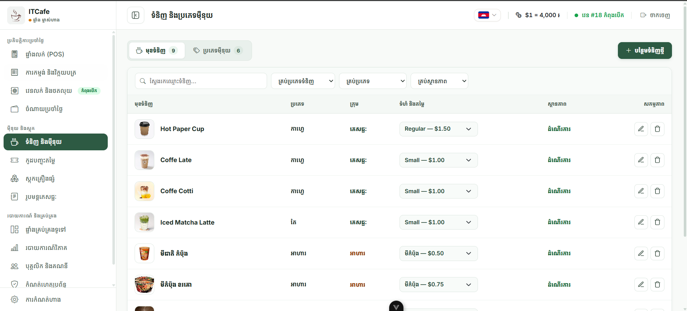

---

### 8. Discount Codes & Promotions (`paegePromocode.png`)
Create and manage promotional discount codes (percentage or fixed amount), usage limits, minimum order rules, and expiration dates.


---

### 9. Inventory & Stock Movements (`pageInventoryStock.png`)
Track raw ingredients (grams, milliliters, pieces), stock health indicators, low-stock alerts, and stock movement ledgers (purchases, sales, waste, adjustments).

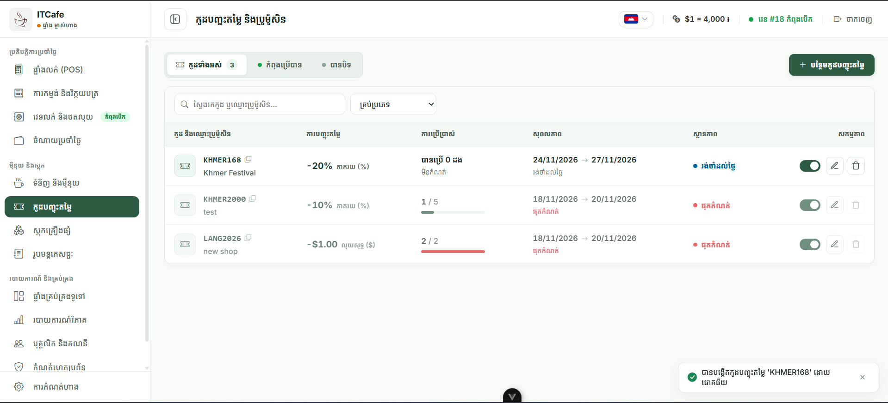

---

### 10. Drink Recipes / Bill of Materials (`pageDrinkRecipes.png`)
Configure ingredient quantities per product variant with automatic sugar-level scaling and estimated cup yield calculations.

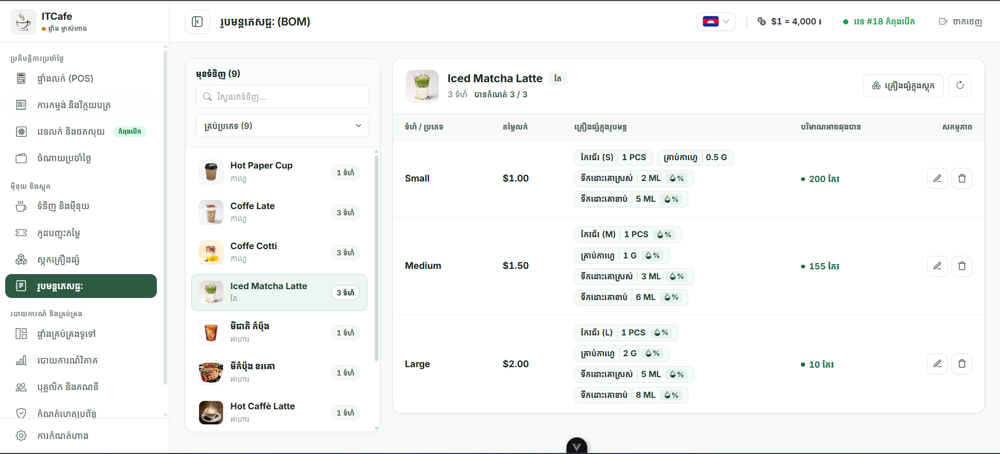

---

### 11. Reports & Analytics (`pageReports.png`)
Detailed analytical reports covering top-selling variants, ingredient consumption, category revenue share, payment methods breakdown, and staff performance.

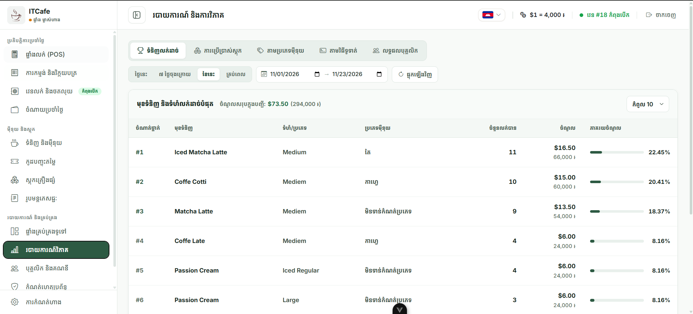

---

### 12. Staff & Users Management (`pageAccStaff&Users.png`)
Manage Owner and Staff accounts, role assignments, account activation status, and password resets.

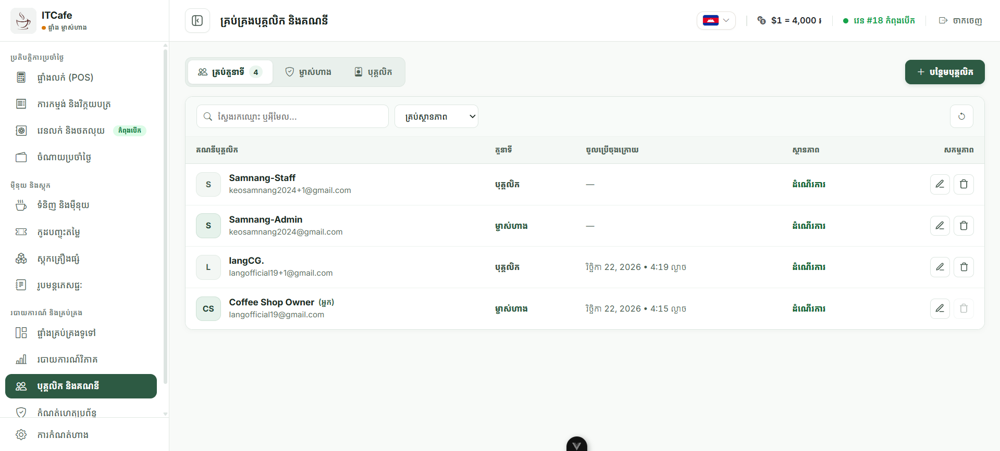

---

### 13. System Audit Logs (`pageAuditLogs.png`)
Security and activity audit trail tracking user actions across modules with timestamps, IP addresses, and JSON payload inspection.

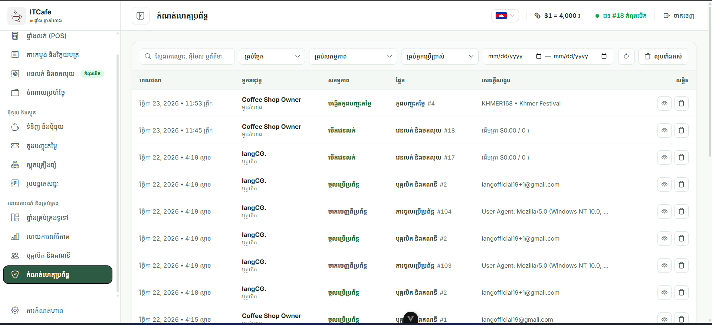

---

### 14. Shop Settings (`pageSetting.png`)
Configure shop profile, logo, USD to KHR exchange rate, tax rate, and thermal receipt layout settings.

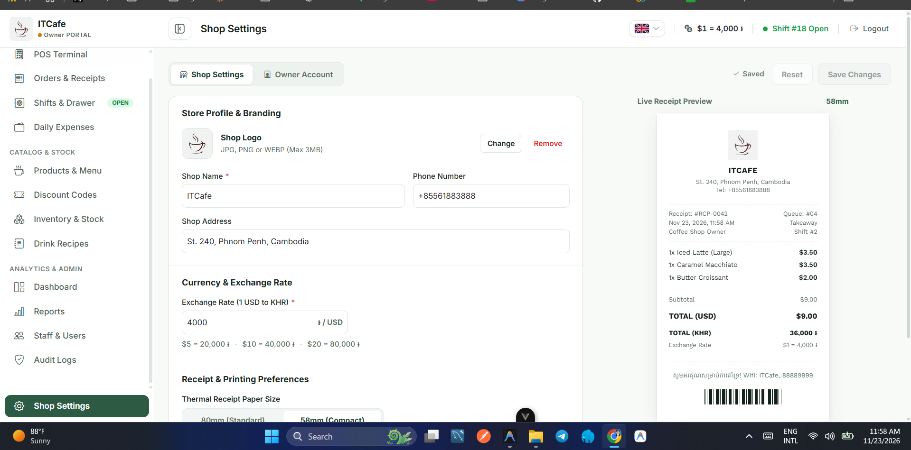

---

## 🚀 Project Setup

### Install Dependencies

```sh
npm install
```

### Compile and Hot-Reload for Development

```sh
npm run dev
```

### Compile and Minify for Production

```sh
npm run build
```

---

© Developed by **Songhai Yeanlang**. All rights reserved.
